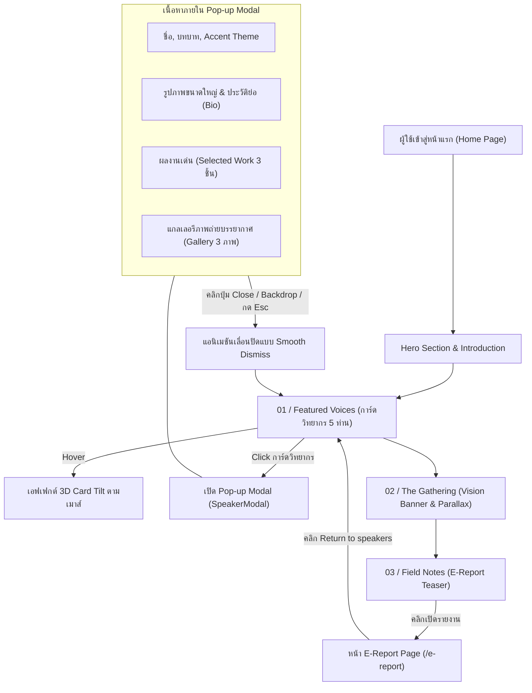

# 📖 เกี่ยวกับโปรเจกต์ (About Project) — Speaker Showcase Website (North Assembly)

เอกสารนี้ระบุภาพรวม วัตถุประสงค์ สถาปัตยกรรมระบบ โครงสร้างไฟล์ และขอบเขตการทำงานของ **Speaker Showcase Website (North Assembly 2024 — Copenhagen)**

---

## 1. ภาพรวมของโปรเจกต์ (Project Overview)

**Speaker Showcase Website** เป็นเว็บแอปพลิเคชันเชิงบรรณาธิการสมัยใหม่ (Modern Editorial & Brutalist Tech Showcase) สร้างขึ้นเพื่อนำเสนอข้อมูลของวิทยากรระดับแนวหน้าทั้ง 5 คน ที่มาร่วมแบ่งปันมุมมองและวิสัยทัศน์ในงานสัมมนา **North Assembly 2024** ณ กรุงโคเปนเฮเกน ภายใต้แนวคิด *"Meet the voices shaping next."* และ *"Curiosity is a form of courage."*

ระบบถูกพัฒนาด้วยเทคโนโลยีสมัยใหม่ **React 19**, **TypeScript 5.7**, **Tailwind CSS v4** และ **Vite 8** โดยมุ่งเน้นการจัดโครงสร้างโค้ดที่สะอาด เป็นระเบียบ เป็นมิตรต่อผู้เริ่มต้น (Beginner-Friendly) และมีความลื่นไหลทางสายตาสูงสุด

### 🌟 จุดเด่นและปรัชญาของโปรเจกต์ (Core Highlights & Philosophy):
- **Modular Component Architecture:** โค้ดถูกแบ่งแยกความรับผิดชอบอย่างชัดเจน (Single Responsibility Principle) โดยแยกประเภทข้อมูล (`src/types/`), ข้อมูลตั้งต้น (`src/data/`), และคอมโพเนนต์แสดงผล (`src/components/`) เพื่อให้ง่ายต่อการอ่าน ทำความเข้าใจ และขยายขอบเขตการทำงาน
- **Interactive 3D Card Tilt & Ambient Depth:** การ์ดวิทยากรมีการคำนวณตำแหน่งพิกัดเคอร์เซอร์เมาส์แบบไดนามิก เพื่อสร้างมิติการเอียงแบบ 3 มิติ (3D Perspective Tilt) ผสานกับแสง Ambient Blur ลอยละล่องด้านหลัง
- **Rich Interactive Speaker Modal (Pop-up):** เมื่อผู้ใช้คลิกเลือกการ์ดวิทยากรคนใดคนหนึ่ง ระบบจะแสดง Pop-up Modal รายละเอียดแบบครบถ้วน:
  - ชื่อวิทยากร (Speaker Name) และหัวข้อบรรยายหลัก (Topic)
  - รูปภาพวิทยากรขนาดใหญ่ (Hero Portrait Image) พร้อมบทบาทหน้าที่ (Role)
  - ชีวประวัติและแนวคิดเชิงลึก (Bio)
  - ผลงานเด่นและการยอมรับในระดับสากล (Selected Work / Recognition 3 รายการ)
  - แกลเลอรีภาพถ่ายบรรยากาศงานและกิจกรรม (Event Gallery 3 ภาพ)
  - แถบสีและโทนสีประจำตัวเฉพาะคน (Individual Accent Color Theme)
  - ระบบปิดที่นุ่มนวล (Smooth Exit Animation) รองรับทั้งการคลิกปุ่ม Close, คลิกพื้นที่ Backdrop ด้านนอก และการกดปุ่ม `Escape` บนคีย์บอร์ด
- **Fluid Typography & Local Self-hosted Fonts:** ใช้งานฟอนต์ระดับพรีเมียม **"Manrope"** (สำหรับหัวข้อทรงพลัง) และ **"DM Sans"** (สำหรับเนื้อหาที่สบายตา) ในรูปแบบ Local Self-hosted WOFF2 พร้อมระบบ Preload ใน `index.html` และ Fallback จาก Google Fonts เพื่อประสิทธิภาพการเรนเดอร์และความเสถียรสูงสุด
- **Accessible & Motion-Aware UX:** รองรับ `prefers-reduced-motion` สำหรับผู้ใช้ที่ต้องการลดความเคลื่อนไหว, การจัดการ Focus Trap และการล็อกการเลื่อนหน้าเว็บพื้นหลัง (`body.modal-open`) ขณะเปิด Pop-up Modal

---

## 2. ข้อมูลวิทยากรทั้ง 5 คน (Featured Speakers)

| ลำดับ | ชื่อวิทยากร (Name) | บทบาทหน้าที่ (Role) | หัวข้อบรรยาย (Topic) | สีประจำตัว (Accent) |
|:---:|---|---|---|:---:|
| **01** | **Maya Chen** | FUTURIST & AUTHOR | Designing Tomorrow | `#ff5c35` (ส้มอมแดง) |
| **02** | **Elias North** | CLIMATE ARCHITECT | Cities That Breathe | `#c8ff62` (เขียวมะนาว) |
| **03** | **Amara Okafor** | CREATIVE DIRECTOR | Culture Is the Brief | `#b69cff` (ม่วงพาสเทล) |
| **04** | **Julian Reyes** | AI RESEARCHER | Beyond Intelligence | `#73cfff` (ฟ้าสว่าง) |
| **05** | **Noor Al-Sayed** | SOCIAL ENTREPRENEUR | The Radical Local | `#ffd166` (เหลืองทอง) |

---

## 3. ผังโครงสร้างไดเรกทอรีของโปรเจกต์ (Directory Structure)

```text
ComSciWork/
├── .antigravityignore       # การกำหนดค่าข้ามไฟล์ที่ไม่จำเป็นสำหรับ AI Agent
├── CheckSystem/             # ระบบตรวจสอบอัตโนมัติ (Automated Quality & Integrity Suite)
│   ├── run-all-checks.js    # Master Runner รันการตรวจสอบทั้งระบบ (npm run check-system)
│   ├── check-path-links.js  # ตรวจสอบความถูกต้องของ Assets, Imports และ Markdown Links
│   ├── check-markdown-rules.js # ตรวจสอบกฎ Markdown (De Morgan, Naming, Types, a11y, Security)
│   ├── check-state-lifecycle.js # ตรวจสอบ State Colocation, Memory Leaks, และ Event Cleanups
│   └── README.md            # คู่มือการใช้งานและกฎการดูแลรักษา CheckSystem
├── markdowns/               # เอกสารคู่มือและการพัฒนาโปรเจกต์ (19 ไฟล์)
│   ├── AboutProject.md      # ภาพรวมและสถาปัตยกรรมระบบ (เอกสารนี้)
│   ├── PROJECT.md           # สเปกโครงสร้างระบบและการโต้ตอบของ Component
│   ├── TECHSTACK.md         # รายการเทคโนโลยีและบทบาทหน้าที่ (React 19, TS, Tailwind v4)
│   ├── DESIGN.md            # ระบบการออกแบบ โทนสี Typography และ Animation
│   ├── ...                  # คู่มือทางเทคนิคและแนวทางการพัฒนาอื่นๆ
├── .gitignore               # การกรองไฟล์สำหรับ Git
├── .gitattributes          # การกำหนดค่า Line endings ของ Git
├── .mise.toml               # การกำหนดเวอร์ชัน Node.js
├── AGENTS.md                # สเปกและข้อตกลงของโปรเจกต์
├── CLAUDE.md                # การตั้งค่าเครื่องมือสำหรับ AI
├── index.html               # HTML Shell หลักของระบบ
├── package.json             # รายการ Dependencies และ Scripts ของโปรเจกต์
├── tsconfig.json            # การตั้งค่า TypeScript Compiler
├── vite.config.ts           # การตั้งค่า Vite Build Tool และ Tailwind Plugin
│
├── public/                  # ทรัพยากรคงที่ (Favicon, Static Assets & Local Media)
│   ├── favicon.svg          # ไอคอน Favicon ของเว็บไซต์
│   ├── fonts/               # ฟอนต์ท้องถิ่น (Self-hosted Fonts)
│   │   ├── dmsans.woff2     # ฟอนต์ DM Sans WOFF2
│   │   └── manrope.woff2    # ฟอนต์ Manrope WOFF2
│   └── images/              # คลังรูปภาพความละเอียดสูงท้องถิ่น (8 รูป)
│       ├── speaker-maya.jpg
│       ├── speaker-elias.jpg
│       ├── speaker-amara.jpg
│       ├── speaker-julian.jpg
│       ├── speaker-noor.jpg
│       ├── vision-banner.jpg
│       ├── event-atmosphere-1.jpg
│       └── event-atmosphere-2.jpg
│
└── src/                     # ซอร์สโค้ดหลักของแอปพลิเคชัน
    ├── components/          # คอมโพเนนต์ UI และไฟล์ CSS แบบแยกโมดูล (SRP)
    │   ├── Arrow.tsx          # ไอคอนลูกศรเฉียง (↗) SVG สำหรับปุ่มและลิงก์
    │   ├── CloseIcon.tsx      # ไอคอนปิด (×) SVG สำหรับปุ่มและโมดอล
    │   ├── EReportPage.tsx    # หน้าแสดงรายงานดิจิทัลฉบับเต็ม (/e-report)
    │   ├── EReportPage.css    # สไตล์เฉพาะของหน้ารายงานดิจิทัล
    │   ├── EReportTeaser.tsx  # ส่วนโปรโมตรายงานฉบับดิจิทัล (Section 03)
    │   ├── EReportTeaser.css  # สไตล์เฉพาะของส่วนโปรโมตรายงาน
    │   ├── Navbar.tsx         # แถบนำทางด้านบน (ใช้งานร่วมกันทั้งหน้าหลักและรายงาน)
    │   ├── Navbar.css         # สไตล์เฉพาะของแถบนำทาง
    │   ├── SpeakerCard.tsx    # การ์ดแสดงข้อมูลวิทยากรพร้อมมิติ 3D Tilt
    │   ├── SpeakerCard.css    # สไตล์เฉพาะของการ์ดวิทยากรและ Grid
    │   ├── SpeakerModal.tsx   # Pop-up Modal แสดงรายละเอียดวิทยากรแบบเจาะลึก
    │   ├── SpeakerModal.css   # สไตล์เฉพาะของ Pop-up Modal
    │   ├── VisionBanner.tsx   # ส่วนแบนเนอร์วิสัยทัศน์พร้อม Parallax & Ticker
    │   └── VisionBanner.css   # สไตล์เฉพาะของแบนเนอร์วิสัยทัศน์
    ├── data/                # ข้อมูลตั้งต้นของระบบ
    │   └── speakers.ts        # ข้อมูลวิทยากร 5 คนและ Local Image Assets
    ├── hooks/               # Custom React Hooks
    │   └── useReducedMotion.ts# ฮุกตรวจสอบการตั้งค่าลดความเคลื่อนไหว (a11y)
    ├── types/               # การนิยามโครงสร้างข้อมูล (TypeScript Interfaces)
    │   └── speaker.ts         # ชนิดข้อมูล Speaker Model
    ├── App.tsx              # หน้าหลักและตัวควบคุม State (Root Orchestrator)
    ├── App.css              # สไตล์เฉพาะของส่วน Hero Intro, Glows และ Footer
    ├── index.css            # สไตล์ชีตรวมศูนย์ (Tailwind v4, Local @font-face & Keyframes)
    ├── main.tsx             # จุดเริ่มต้นเรนเดอร์ React แอปพลิเคชันสู่ DOM
    └── vite-env.d.ts        # การประกาศ Environment Types สำหรับ Vite
```

---

## 4. แผนผังการทำงานของระบบ (System Workflow)



---

## 5. นิยามความสำเร็จและมาตรฐานคุณภาพ (Definition of Done)

- [x] **5 Featured Speakers Complete:** ข้อมูลวิทยากรทั้ง 5 คนครบถ้วน ถูกต้องตามสเปก
- [x] **Interactive Pop-up Modal:** แสดงผลชื่อ, ภาพ, ผลงาน, และแกลเลอรีอย่างสมบูรณ์
- [x] **Modular Structure:** แยกโค้ดออกเป็น Components, Types, และ Data อย่างเป็นสัดส่วน
- [x] **100% Type-Safe:** โค้ดผ่านการคอมไพล์ TypeScript 5.7 ปราศจาก `any` หรือ Type Error
- [x] **Production Build Verified:** ผ่านการบิลด์ด้วย Vite 8 ได้ไฟล์ Bundle ที่มีประสิทธิภาพสูง
- [x] **Responsive & Accessible:** รองรับการแสดงผลทุกหน้าจอ (Desktop, Tablet, Mobile) และรองรับการนำทางผ่านคีย์บอร์ด
