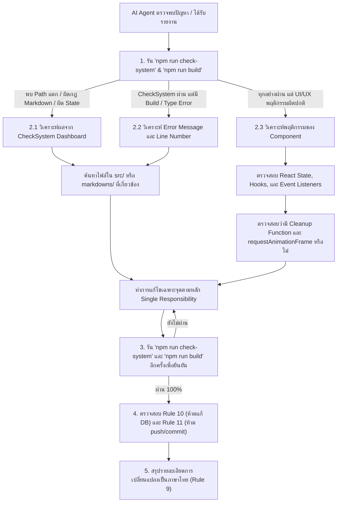

# 🐞 คู่มือการแก้ปัญหาและดีบักสำหรับ AI Agents (AI Agent Debugging & Troubleshooting Guide)

เอกสารนี้รวบรวมแนวทาง มาตรการความปลอดภัย เครื่องมือวินิจฉัย และฐานความรู้ในการแก้ปัญหาทางเทคนิคสำหรับ **AI Agents และวิศวกรซอฟต์แวร์** ในการตรวจสอบ วิเคราะห์ และแก้ไขปัญหาโปรเจกต์ **Speaker Showcase Website (North Assembly)** ภายใต้สถาปัตยกรรม **React 19 + TypeScript 5.7 + Tailwind CSS v4 + Vite 8**

---

## 🤖 1. กฎเหล็กข้อบังคับสำหรับ AI Agents (Mandatory Agent Rules)

เมื่อ AI Agent เข้ามาปฏิบัติงานในโปรเจกต์นี้ **ต้องปฏิบัติตามกฎระเบียบต่อไปนี้อย่างเคร่งครัด**:

| กฎข้อบังคับ | รายละเอียดและข้อห้าม |
|---|---|
| **🔒 Rule 10: ฐานข้อมูล** | **ห้ามนำข้อมูลเข้า หรือสร้าง Table Database เองเด็ดขาด** ปัจจุบันระบบเป็น Pure Frontend หากในอนาคตมี Database ให้สร้างโค้ด SQL มอบให้ผู้ใช้เป็นผู้รันเองเท่านั้น |
| **🚫 Rule 11: Git Version Control** | **ห้ามรันคำสั่ง `git commit` หรือ `git push` ขึ้น GitHub โดยเด็ดขาด** ปล่อยให้ผู้ใช้เป็นผู้ตรวจสอบ ทำการ commit และ push ด้วยตนเองเสมอ |
| **🛡️ Rule 8: การอนุรักษ์โค้ดเดิม** | **ห้ามลบหรือแก้ไขโค้ดเดิมโดยไม่จำเป็น** รักษาสไตล์ คอมโพเนนต์ และฟังก์ชันที่มีอยู่เดิมให้ทำงานได้ต่อเนื่อง |
| **🔍 CheckSystem Maintenance** | **ต้องคอยอัปเดตและรัน CheckSystem เสมอ** เมื่อมีการเพิ่มฟังก์ชัน คอมโพเนนต์ หรือไฟล์ใหม่เข้ามา เพื่อป้องกัน Broken Paths และ Bug |
| **📄 Rule 2: ตรวจสอบ `.antigravityignore` & การดูแล Skills** | ข้ามการอ่านโฟลเดอร์ `node_modules/`, `dist/`, `.git/`, `.figma/`, ไฟล์ล็อก, สำเนาซ้ำ (`.claude/`, `agent/`) และไฟล์ Binary ใน `public/` เพื่อประหยัด Token **แต่ห้ามใส่ `.agents/` หรือ `.agents/skills/` ลงใน `.antigravityignore` โดยเด็ดขาด เพื่อป้องกันไม่ให้ AI Agent เมินหรือไม่ยอมอ่านไฟล์คำสั่งสกิลที่จำเป็น** |
| **✅ Rule 9: การสรุปงาน** | หลังทำการแก้ไขเสร็จสิ้น ต้องรันคำสั่งตรวจสอบบิลด์และสรุปรายละเอียดการเปลี่ยนแปลงเป็นภาษาไทยให้ชัดเจนทุกครั้ง |

---

## 🛠️ 2. เครื่องมือและคำสั่งวินิจฉัยด่วน (Diagnostic Commands)

### 2.1 ตรวจสอบความถูกต้องและสุขอนามัยทั้งระบบ (Automated CheckSystem)
คำสั่งแรกสุดที่ AI Agent ต้องรันเสมอเพื่อตรวจหา Path แตก, ลิงก์เสีย, การละเมิดกฎ Markdown, และข้อผิดพลาดของ State Lifecycle:
```bash
npm run check-system
```
- **สิ่งที่คำสั่งนี้ตรวจสอบ (1,800+ จุดตรวจ):**
  - [`CheckSystem/check-path-links.js`](file:///C:/ComSciWork/CheckSystem/check-path-links.js): ตรวจสอบ Assets ใน `public/`, Import paths ใน `src/`, และลิงก์ทั้งหมดใน `markdowns/`
  - [`CheckSystem/check-markdown-rules.js`](file:///C:/ComSciWork/CheckSystem/check-markdown-rules.js): ตรวจจับเงื่อนไข De Morgan `!(...)`, PascalCase/camelCase, No `any`, a11y (`alt`, `aria-hidden`), และ Security
  - [`CheckSystem/check-state-lifecycle.js`](file:///C:/ComSciWork/CheckSystem/check-state-lifecycle.js): ตรวจสอบ State Colocation, Event Listener Cleanups, Animation Frames, และ DOM Scroll Lock

### 2.2 ตรวจสอบไวยากรณ์และบิลด์ระบบ (Build & Typecheck)
คำสั่งสำหรับตรวจสอบว่าระบบสามารถคอมไพล์และบิลด์ Production Bundle ได้สมบูรณ์หรือไม่:
```bash
npm run build
```
- **สิ่งที่ต้องสังเกต:**
  - สถานะ Exit Code: ต้องเป็น `0`
  - เวลาการบิลด์: ควรอยู่ระหว่าง `400ms – 800ms`
  - ไม่มีข้อความ Error สีแดง หรือคำเตือน TypeScript ใดๆ

### 2.3 ตรวจสอบชนิดข้อมูล TypeScript แบบรวดเร็ว
```bash
npx tsc --noEmit
```
- คำสั่งนี้จะตรวจสอบ Type Safety ทั้งหมดใน `src/` โดยไม่สร้างไฟล์ Output หากผ่านจะไม่มีข้อความใดๆ แสดงออกมา (Exit Code 0)

### 2.4 ตรวจสอบรูปแบบโค้ด (Code Formatting)
```bash
npm run format
```
- จัดระเบียบโค้ดตามมาตรฐานของโปรเจกต์ด้วย `oxfmt`

---

## 📚 3. ฐานความรู้ข้อผิดพลาดที่พบบ่อยและวิธีแก้ไข (Known Issues & Solutions)

### 3.1 ฟอนต์ไม่แสดงผล หรือเกิดข้อผิดพลาด `OTS parsing error: invalid sfntVersion: 1986359923`
* **อาการ:** เบราว์เซอร์แจ้งเตือน `Failed to decode downloaded font: .../fonts/manrope.woff2` และ `OTS parsing error: invalid sfntVersion: 1986359923`
* **สาเหตุรากเหง้า:**
  - ไฟล์ `.gitattributes` มีการกำหนดให้ `*.woff2` หรือ `*.woff` ทำงานผ่าน Git LFS (`filter=lfs`)
  - ทำให้บน Git Repository กลายเป็น Text Pointer ขนาด 130 ไบต์ที่ขึ้นต้นด้วยตัวอักษร `"vers"` (`0x76657273` แปลงเป็นเลขฐาน 10 ได้ `1986359923`)
  - เมื่อ Vercel หรือเซิร์ฟเวอร์ไม่ได้ดึง Git LFS Binary จึงส่งไฟล์ Text ให้เบราว์เซอร์ ทำให้ OpenType Sanitizer พัง
* **วิธีแก้ไข:**
  1. แก้ไข [`.gitattributes`](file:///C:/ComSciWork/.gitattributes) ให้ติดตามนามสกุลฟอนต์และรูปภาพเว็บเป็น `binary` (ไม่ใช่ Git LFS)
  2. รัน `git rm --cached -r public/fonts public/images` แล้วตามด้วย `git add .gitattributes public/fonts public/images` เพื่อเก็บเป็น Native Git Blobs
  3. กำหนด `local('DM Sans')` และ `local('Manrope')` ใน `@font-face` ของ [`src/index.css`](file:///C:/ComSciWork/src/index.css) เพื่อดึงฟอนต์เครื่องก่อน
  4. เพิ่ม `<link rel="preload">` และ Google Fonts CDN Fallback ใน [`index.html`](file:///C:/ComSciWork/index.html)

---

### 3.2 คำเตือน `[Intervention] Images loaded lazily and replaced with placeholders`
* **อาการ:** รูปภาพบนหน้าเว็บไม่แสดง หรือเบราว์เซอร์ Edge/Chromium แสดงคำเตือน Intervention
* **สาเหตุรากเหง้า:**
  - รูปภาพด้านบนสุด (Above-the-fold) เช่น การ์ดวิทยากรใบแรก มีการใส่ `loading="lazy"` โดยไม่มีการกำหนดขนาด (`width`/`height`) หรือรูปภาพเป็นไฟล์เสีย (เช่น LFS Pointer)
  - Chromium เข้าแทรกแซงเพื่อลดการใช้ทรัพยากรบนเครือข่ายความเร็วต่ำ และใส่ Placeholder แทน
* **วิธีแก้ไข:**
  1. กำหนดให้รูปภาพที่อยู่เหนือรอยพับหน้าจอ (`index < 2`) โหลดแบบ `loading="eager"` และระบุ `fetchPriority="high"` สำหรับใบแรกสุด
  2. เพิ่มคุณสมบัติ `decoding="async"`
  3. ระบุ `width` และ `height` หรือสัดส่วน `aspect-ratio` ชัดเจนในแท็ก `` เสมอ

---

### 3.3 คำเตือน `Option 'baseUrl' is deprecated and will stop functioning in TypeScript 7.0`
* **อาการ:** TypeScript Compiler หรือ VS Code แจ้งเตือนใน [`tsconfig.json`](file:///C:/ComSciWork/tsconfig.json) บรรทัด `baseUrl`
* **สาเหตุรากเหง้า:** ใน TypeScript 6.0+ ตัวเลือก `baseUrl` ถูก Deprecate เนื่องจากในโหมด `"moduleResolution": "bundler"` หรือ `"node16"` การกำหนด `"paths"` สามารถ Resolve เทียบกับโฟลเดอร์ Root ของ `tsconfig.json` ได้โดยตรง
* **วิธีแก้ไข:**
  - ลบบรรทัด `"baseUrl": "."` ออกจาก `compilerOptions` ใน [`tsconfig.json`](file:///C:/ComSciWork/tsconfig.json) โดยคงการตั้งค่า `"paths": { "@/*": ["./src/*"] }` ไว้

---

### 3.4 หน้าจอค้าง เลื่อนไม่ได้หลังปิด Pop-up Modal
* **อาการ:** เมื่อคลิกปิด `SpeakerModal` แล้ว พื้นหลังหน้าเว็บหลักยังคงถูกล็อก ไม่สามารถเลื่อนหน้าจอได้
* **สาเหตุรากเหง้า:** คลาส `modal-open` บน `document.body` ไม่ถูกลบออกเมื่อ Component ถูก Unmount
* **วิธีแก้ไข:** ตรวจสอบ Cleanup Function ใน `useEffect` ของ [`src/components/SpeakerModal.tsx`](file:///C:/ComSciWork/src/components/SpeakerModal.tsx):
  ```typescript
  useEffect(() => {
    document.body.classList.add("modal-open");
    return () => {
      document.body.classList.remove("modal-open");
    };
  }, []);
  ```

---

### 3.5 การ์ด 3D Tilt หรือ Parallax มีอาการกระตุก หรือเกิด Memory Leak
* **อาการ:** แอนิเมชันไม่ลื่นไหล หรือเกิดปัญหา Memory Leak เมื่อรันใน React Strict Mode
* **สาเหตุรากเหง้า:** เก็บค่า Frame ID ของ `requestAnimationFrame` ไว้ในตัวแปร Closure ทั่วไป แทนที่จะเก็บใน `useRef` หรือไม่ได้เรียก `cancelAnimationFrame` ในฟังก์ชัน Cleanup
* **วิธีแก้ไข:**
  - ประกาศ `const tiltFrame = useRef<number>(0)`
  - สั่ง `cancelAnimationFrame(tiltFrame.current)` ก่อนเรียก `requestAnimationFrame` รอบใหม่
  - ใส่ Cleanup Function ใน `useEffect` เสมอ:
    ```typescript
    useEffect(() => {
      return () => cancelAnimationFrame(tiltFrame.current);
    }, []);
    ```

---

### 3.6 TypeScript Error เมื่อใส่ CSS Custom Properties ในแอตทริบิวต์ `style`
* **อาการ:** `Type '{ "--accent": string; }' is not assignable to type 'Properties<string | number, string & {}>'`
* **สาเหตุรากเหง้า:** React Style Types โดยค่าเริ่มต้นไม่รองรับ Custom Properties ที่ขึ้นต้นด้วยขีดสองตัว (`--`)
* **วิธีแก้ไข:** ทำ Type-Casting ด้วย `as React.CSSProperties`:
  ```tsx
  style={{ "--accent": speaker.accent } as React.CSSProperties}
  ```

---

## 🧭 4. แผนผังโปรโตคอลการดีบักสำหรับ AI Agent (Agent Decision Tree)



---

## 📋 5. เช็กลิสต์การส่งมอบงานดีบัก (Debug Verification Checklist)

ก่อนที่ AI Agent จะแจ้งผู้ใช้ว่าการดีบักเสร็จสิ้น ให้ตรวจสอบตามเกณฑ์ต่อไปนี้:
- [x] คำสั่ง `npm run check-system` ผ่าน 100% (1,800+ จุดตรวจสมบูรณ์, 0 Errors)
- [x] มีการอัปเดตไฟล์ใน `CheckSystem/` หากมีการเพิ่มฟังก์ชัน คอมโพเนนต์ หรือไฟล์ใหม่เข้ามา
- [x] คำสั่ง `npm run build` ผ่านโดยสมบูรณ์ (Exit Code 0, 0 Errors, 0 Warnings)
- [x] คำสั่ง `npx tsc --noEmit` ผ่านโดยสมบูรณ์ ไม่มีข้อความผิดพลาด
- [x] โค้ดที่แก้ไขสอดคล้องกับ [DeMorgansLaws.md](file:///C:/ComSciWork/markdowns/DeMorgansLaws.md) (ไม่มีเงื่อนไขปฏิเสธซ้อน)
- [x] ไม่มีคำสั่ง `any` ในโค้ด TypeScript
- [x] ไม่มีคำสั่งแก้ไข Database โดยพลการ (Rule 10)
- [x] **ไม่มีการรัน `git commit` หรือ `git push` โดยเด็ดขาด (Rule 11)**
