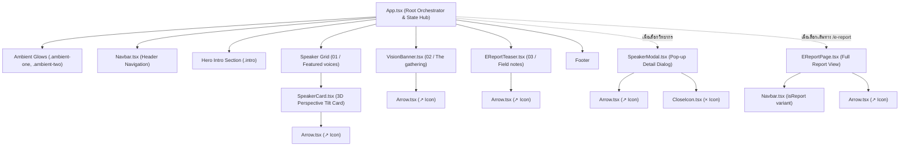

# 🧩 สถาปัตยกรรมคอมโพเนนต์และการไหลของข้อมูล (Component Architecture & Data Flow Guide)

> 📌 **หมายเหตุการปรับปรุงสถาปัตยกรรม (Legacy Architecture Archived):**  
> สถาปัตยกรรมเดิมที่ใช้ PHP 8 Procedural ได้ถูกยุติการใช้งานและจัดเก็บเข้าสู่สถานะ Archive อย่างสมบูรณ์ เนื่องจากโปรเจกต์ปัจจุบันได้รับการยกเครื่องใหม่ทั้งหมดสู่สถาปัตยกรรม **Modern Component-Driven Single Page Application (React 19 + TypeScript 5.7)**  
> เอกสารฉบับนี้จึงได้รับการปรับปรุงเพื่อใช้เป็น **คู่มือโครงสร้างและสถาปัตยกรรมคอมโพเนนต์ (Component Architecture)** ของระบบหลักในปัจจุบัน

---

## 1. ผังลำดับชั้นของคอมโพเนนต์ (Component Hierarchy)

ระบบถูกออกแบบตามหลักสถาปัตยกรรมคอมโพเนนต์สมัยใหม่ โดยแบ่งแยกบทบาทหน้าที่อย่างชัดเจน:

---

## 2. การไหลของข้อมูลทางเดียว (Unidirectional Data Flow)

- **Props Down, Events Up:**
  - **ข้อมูลไหลลง (Data Flows Down):** ข้อมูลวิทยากร (`Speaker`) และสถานะต่างๆ ถูกส่งผ่าน Props จาก `App.tsx` ไปยังคอมโพเนนต์ลูก เช่น ส่ง `speaker={selected}` ไปยัง `SpeakerModal.tsx` หรือส่ง `speaker={speaker}` ไปยัง `SpeakerCard.tsx`
  - **การแจ้งเตือนเหตุการณ์ย้อนกลับ (Events Flow Up):** เมื่อเกิดการกระทำในคอมโพเนนต์ลูก (เช่น การคลิกปิด Modal หรือการคลิกย้อนกลับ) คอมโพเนนต์ลูกจะเรียก Callback Function ที่ได้รับมาจาก Props (เช่น `onClose()`, `onBack()`) เพื่อแจ้งให้ `App.tsx` อัปเดต State ส่วนกลาง

---

## 3. รายละเอียดหน้าที่ของแต่ละคอมโพเนนต์ (Component Responsibilities)

| คอมโพเนนต์ | ตำแหน่งไฟล์ | หน้าที่และความรับผิดชอบ |
|---|---|---|
| **`App`** | [src/App.tsx](file:///C:/ComSciWork/src/App.tsx) | จัดการ Global State (`selected`, `route`), ประสานงานคอมโพเนนต์หลัก (Root Orchestrator) |
| **`Navbar`** | [src/components/Navbar.tsx](file:///C:/ComSciWork/src/components/Navbar.tsx) | แถบนำทางด้านบนส่วนหัว แสดงโลโก้ `NORTH24` และลิงก์นำทาง รองรับทั้งหน้าหลักและหน้ารายงาน |
| **`SpeakerCard`** | [src/components/SpeakerCard.tsx](file:///C:/ComSciWork/src/components/SpeakerCard.tsx) | การ์ดแสดงข้อมูลวิทยากร พร้อมคำนวณการเอียง 3D Perspective Tilt และแสงสะท้อนเรเดียล |
| **`SpeakerModal`** | [src/components/SpeakerModal.tsx](file:///C:/ComSciWork/src/components/SpeakerModal.tsx) | แสดง Pop-up ข้อมูลวิทยากรแบบเจาะลึก (ชื่อ, รูป, ประวัติ, ผลงาน 3 ชิ้น, แกลเลอรี 3 ภาพ, Accent Theme) พร้อม Smooth Exit Timing |
| **`VisionBanner`** | [src/components/VisionBanner.tsx](file:///C:/ComSciWork/src/components/VisionBanner.tsx) | แบนเนอร์วิสัยทัศน์พร้อม Parallax Image Background, Intersection Observer และ Ticker ข้อความวิ่ง |
| **`EReportTeaser`** | [src/components/EReportTeaser.tsx](file:///C:/ComSciWork/src/components/EReportTeaser.tsx) | การ์ดโปรโมตรายงานดิจิทัลพร้อมลูกเล่นวงโคจร (Rotating Orbit) และปุ่มเปิดรายงาน |
| **`EReportPage`** | [src/components/EReportPage.tsx](file:///C:/ComSciWork/src/components/EReportPage.tsx) | หน้าอ่านรายงานดิจิทัลฉบับเต็ม พร้อมรายการ 5 บทและข้อความสรุป |
| **`Arrow`** | [src/components/Arrow.tsx](file:///C:/ComSciWork/src/components/Arrow.tsx) | ไอคอนลูกศรเฉียง (↗) SVG พร้อม `aria-hidden="true"` สำหรับปุ่มและลิงก์ |
| **`CloseIcon`** | [src/components/CloseIcon.tsx](file:///C:/ComSciWork/src/components/CloseIcon.tsx) | ไอคอนปิด (×) SVG พร้อม `aria-hidden="true"` สำหรับปุ่ม Close บนโมดอล |